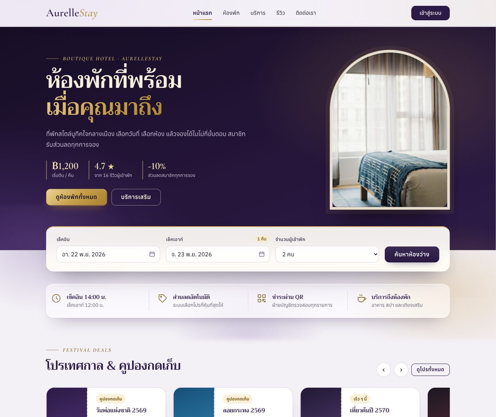
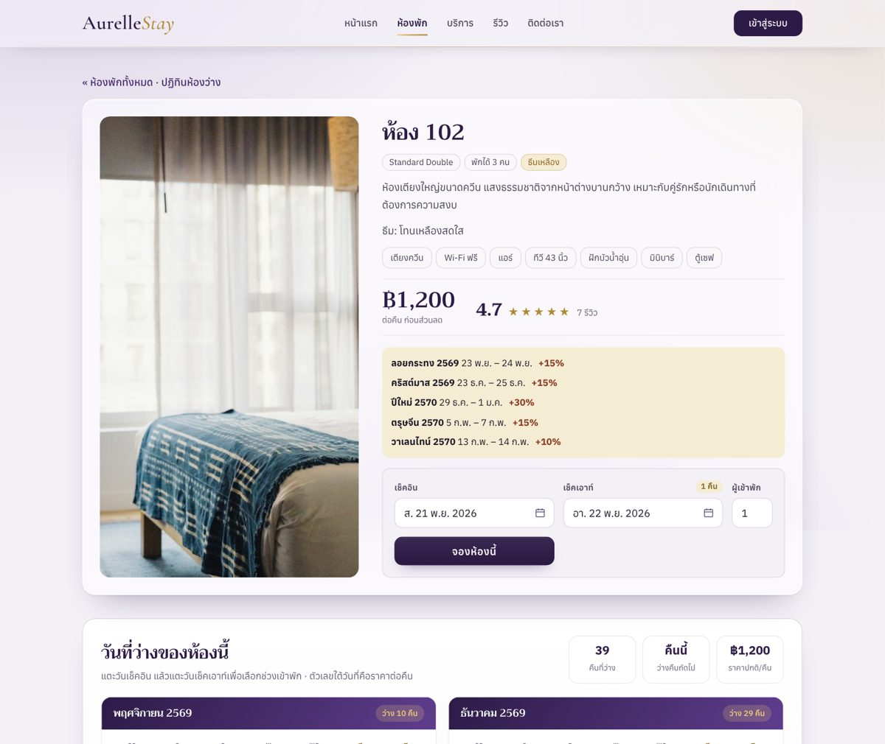
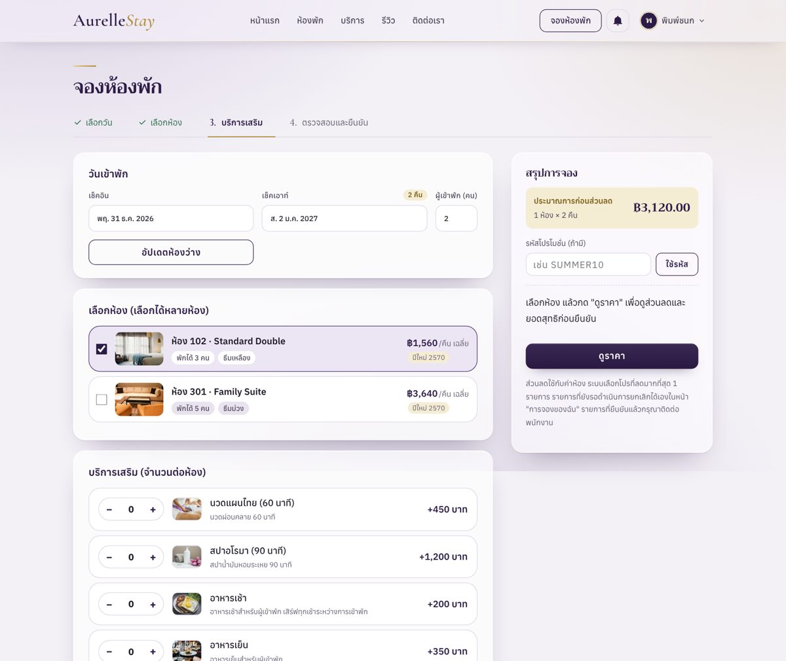
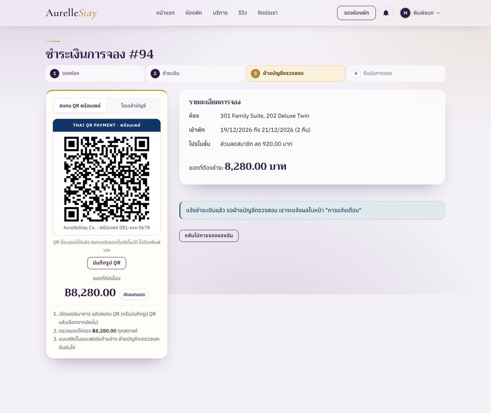
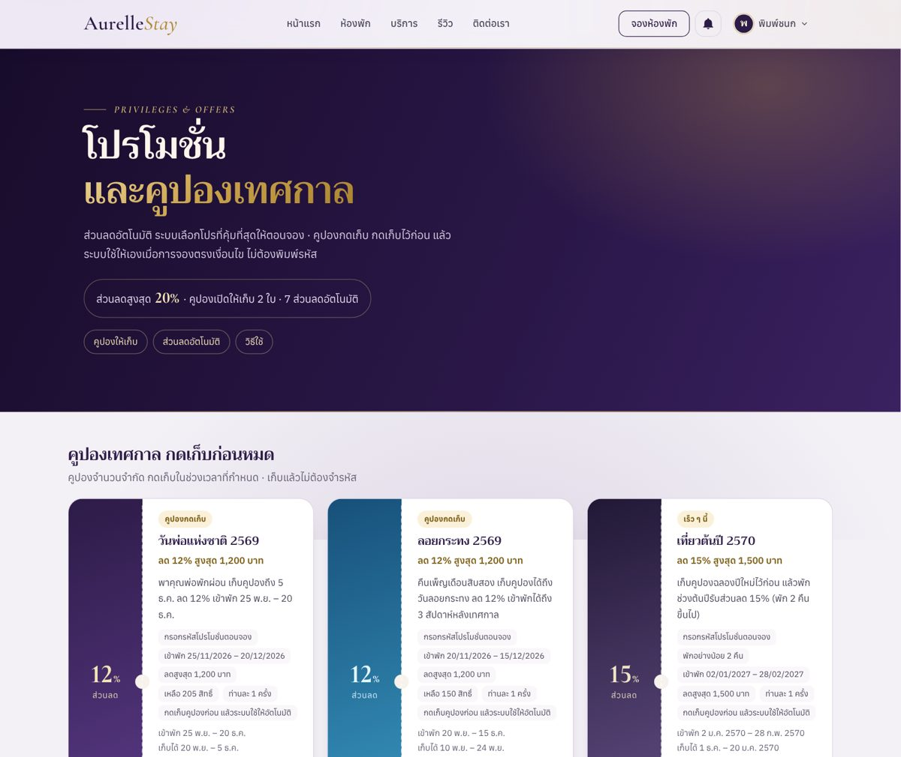
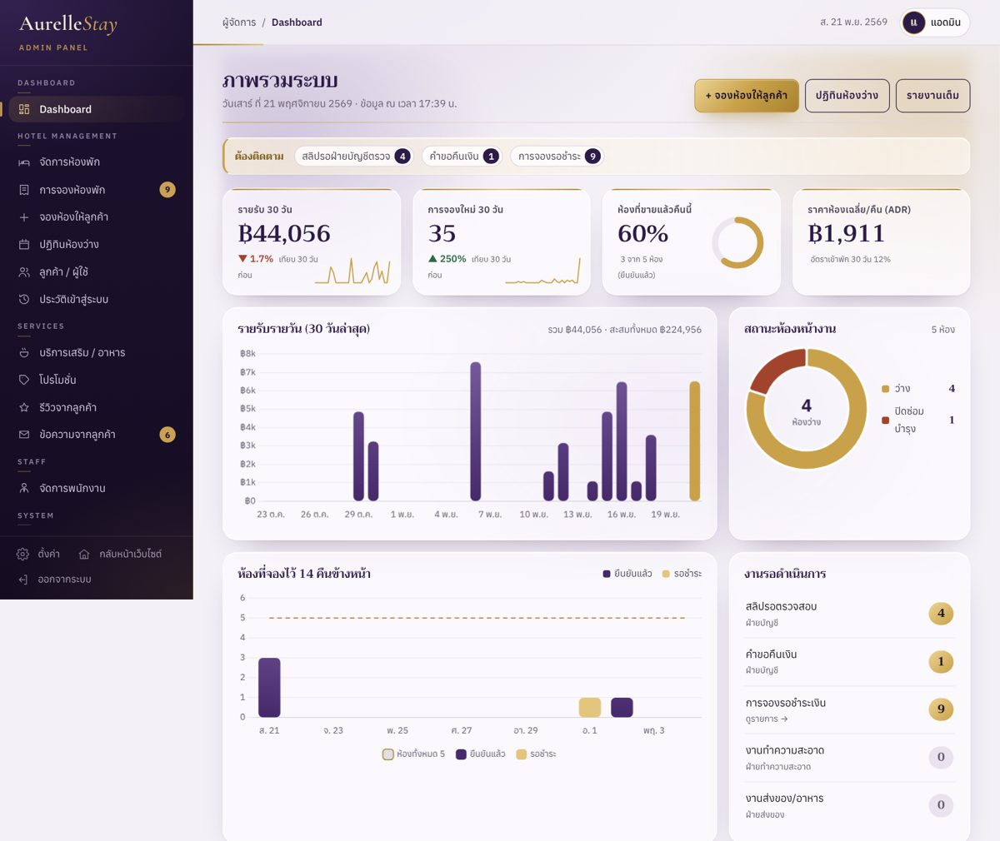
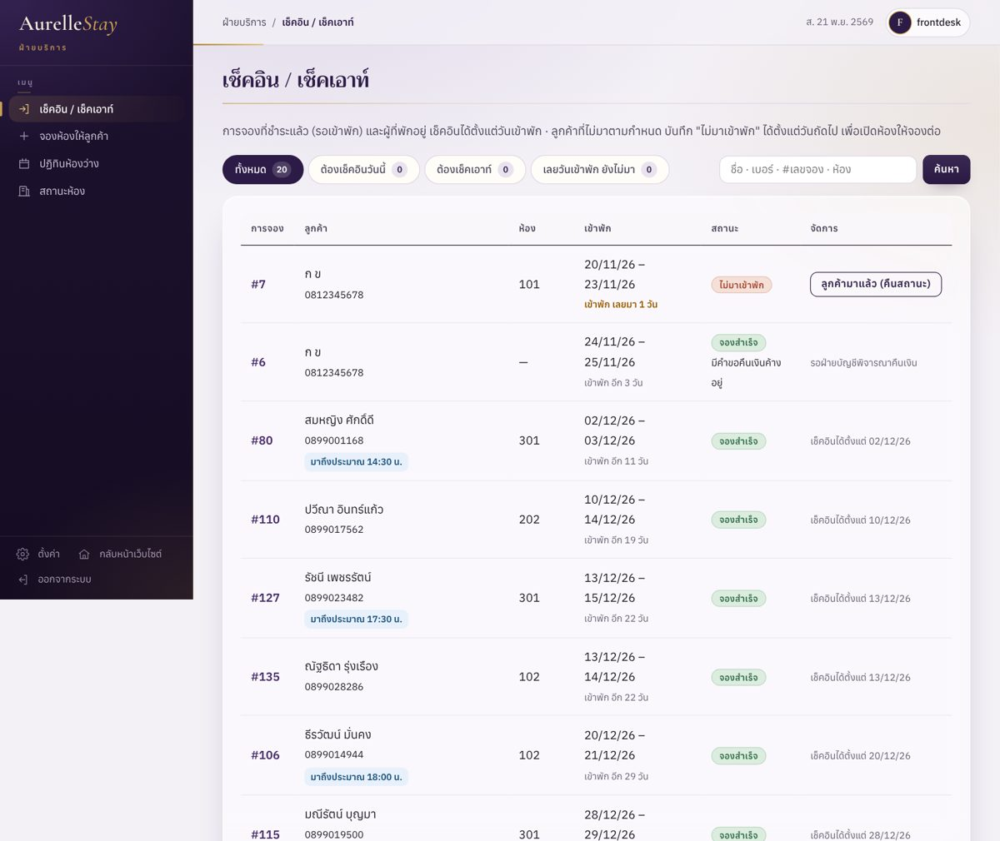
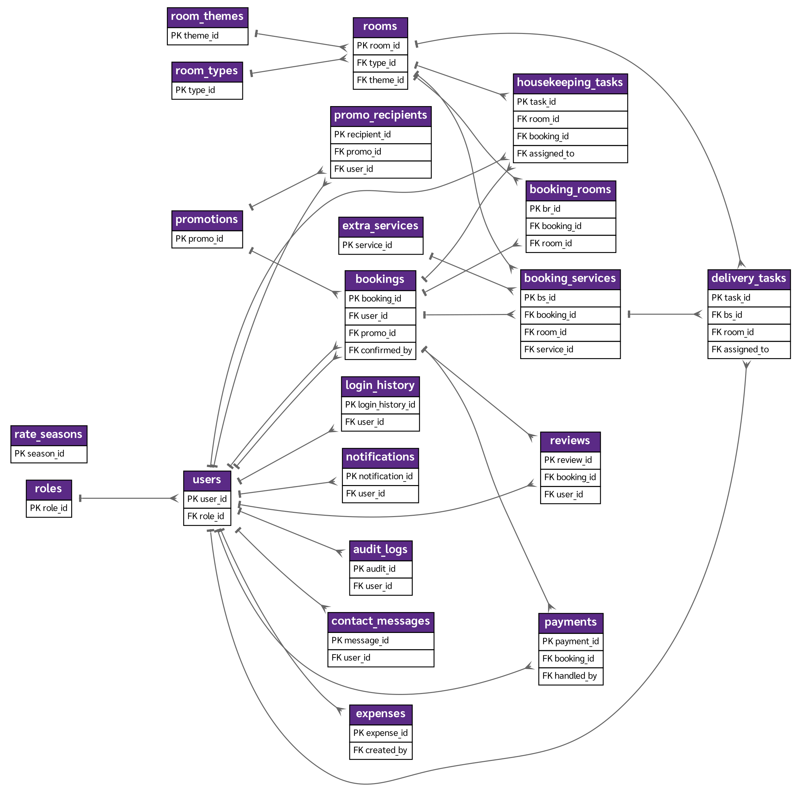

<p align="center"></p>

<h3 align="center">ระบบเว็บไซต์จองห้องพักโรงแรม — ASP.NET Core MVC + MySQL</h3>

<p align="center">
  
  
  
  
  
</p>

AurelleStay เป็นเว็บไซต์จองห้องพักโรงแรมแบบครบวงจร ลูกค้าค้นหาห้องว่าง ดูปฏิทินวันว่างพร้อมราคารายคืน จองหลายห้องพร้อมบริการเสริม รับส่วนลดและคูปองเทศกาล ชำระเงินด้วย QR พร้อมเพย์แล้วแนบสลิป ไปจนถึงเช็คอินออนไลน์และรีวิวหลังเข้าพัก
หลังบ้านแบ่งงานตามฝ่ายของโรงแรมจริง 5 ฝ่าย และทุกบทบาทถูกบังคับสิทธิ์ที่ฝั่งเซิร์ฟเวอร์

> โปรเจกต์รายวิชา CSI402 การเชื่อมต่อโปรแกรมส่วนหน้ากับโปรแกรมส่วนหลัง

<p align="center"></p>

## ฟีเจอร์หลัก

**ลูกค้า**
- ค้นหาห้องตามวันที่ จำนวนคน ราคา และธีม · ปฏิทินวันว่างรายห้องพร้อมราคารายคืน
- จองได้หลายห้องพร้อมบริการเสริม/เตียงเสริม · ระบบกันจองห้องซ้อน
- ราคาตามฤดูกาลและเทศกาลไทยอัตโนมัติ (สงกรานต์ ปีใหม่ ลอยกระทง ฯลฯ)
- ส่วนลดอัตโนมัติ (สมาชิก, Early Bird, วันเกิด, พักยาว) และ **คูปองกดเก็บ** — ระบบเลือกส่วนลดที่คุ้มที่สุดให้
- ชำระเงินด้วย **QR พร้อมเพย์ระบุยอด** (มาตรฐาน EMVCo) หรือโอนเข้าบัญชี แล้วแนบสลิป
- เช็คอินออนไลน์ (แจ้งเวลามาถึง/คำขอพิเศษ) · เพิ่มลงปฏิทิน (.ics / Google Calendar)
- ใบยืนยันการจอง/ใบเสร็จ · ยกเลิก/ขอคืนเงิน · รีวิว · การแจ้งเตือนแบบสด + **อีเมล**
- **ลืมรหัสผ่าน** ตั้งรหัสใหม่เองผ่านลิงก์ในอีเมล · **รอห้องว่าง** ห้องเต็มก็ลงชื่อรอ ระบบแจ้งเมื่อมีคนยกเลิก
- **กิจกรรมของโรงแรม** ผู้เข้าพักจองรอบกิจกรรม แผนกต้อนรับเช็คชื่อ ผู้จัดการจัดการกิจกรรม
- **ฝ่ายส่งของ** ลูกค้าขอของใช้เพิ่มระหว่างพัก · สถานะ รอรับงาน → กำลังนำส่ง → ส่งแล้ว / ไม่พบผู้เข้าพัก · งานด่วน + จับเวลา · สถิติรายพนักงาน
- **ฝ่ายแม่บ้าน** ลูกค้าขอทำความสะอาด/ติดป้ายห้ามรบกวน · ด่วนอัตโนมัติเมื่อมีแขกเข้าวันนี้ · แจ้งซ่อม → ผู้จัดการปิดห้องซ่อม · สถิติ

**หลังบ้าน**
| บทบาท | ทำอะไรได้ |
|---|---|
| ฝ่ายบัญชี | ตรวจสลิป ยืนยัน/ปฏิเสธการชำระเงิน อนุมัติคืนเงิน บันทึกรายจ่าย |
| ฝ่ายบริการ (ฟรอนต์) | รายการเข้าพัก/ออกวันนี้ เช็คอิน เช็คเอาท์ ไม่มาเข้าพัก จองหน้าเคาน์เตอร์ |
| ฝ่ายส่งของ | งานนำส่งเตียงเสริมและบริการถึงห้อง |
| ฝ่ายทำความสะอาด | งานทำความสะอาดห้องหลังเช็คเอาท์ |
| ผู้จัดการ | Dashboard, ห้องและราคา, บริการ, โปรโมชั่น, พนักงาน, รายงาน + CSV, บันทึกกิจกรรม, สำรองข้อมูล, ข้อมูลตัวอย่างสำหรับสาธิต |

เข้าสู่ระบบด้วยอีเมล + รหัสผ่านอย่างเดียว ระบบพาไปหน้าของบทบาทบัญชีนั้นเอง

## ภาพหน้าจอ

| รายละเอียดห้อง + ปฏิทินวันว่าง | จองห้อง |
|---|---|
|  |  |
| **ชำระเงิน (QR พร้อมเพย์)** | **โปรโมชั่นและคูปอง** |
|  |  |
| **Dashboard ผู้จัดการ** | **ฝ่ายบริการ (ฟรอนต์)** |
|  |  |

## เริ่มใช้งานด้วยคำสั่งเดียว

```powershell
dotnet run
```

ระบบจะเปิด Docker Desktop (ถ้ายังไม่เปิด) → เปิดฐานข้อมูล MySQL ใน Docker → รันเว็บที่ http://localhost:5290 และอัปเดตเว็บใน Docker ที่ http://localhost:8088 ให้เป็นโค้ดล่าสุดเบื้องหลัง — ทั้งสองเว็บใช้ข้อมูลชุดเดียวกัน
(ไม่ต้องการ Docker: ตั้ง `AURELLE_NO_DOCKER=1` แล้วระบบจะใช้ฐานข้อมูลตาม `appsettings.json`)

## เริ่มใช้งาน (Docker — แนะนำ)

ต้องมี [Docker Desktop](https://www.docker.com/products/docker-desktop/) เท่านั้น

```powershell
git clone https://github.com/l0w0l-0/AurelleStay.git
cd AurelleStay
powershell -ExecutionPolicy Bypass -File .\docker.ps1 up          # สร้าง .env (รหัสสุ่ม) + เว็บ + MySQL 8
```

1. เปิด http://localhost:8088 แล้วสมัครสมาชิก 1 บัญชี
2. ตั้งบัญชีนั้นเป็นผู้จัดการ: `powershell -ExecutionPolicy Bypass -File .\docker.ps1 admin อีเมลของคุณ`
3. เข้าสู่ระบบใหม่ → สร้างบัญชีพนักงานที่เมนู **พนักงาน**
4. (สาธิต) เมนู **สถานะระบบ / สำรองข้อมูล** → **สร้างข้อมูลตัวอย่าง** ได้ลูกค้า 30 คนพร้อมการจอง การชำระเงิน และรีวิว (`guest01`–`guest30@demo.aurellestay.local` รหัส `Demo@2026`) ลบออกได้ด้วยปุ่มเดียว

5. (ข้อมูลเพิ่ม) `.\docker.ps1 moredata` เพิ่มห้องพักเป็น 19 ห้อง บริการเสริม 15 รายการ กิจกรรม 11 รายการ และพนักงานฝ่ายละ 1–3 คน (รันซ้ำได้ ไม่ลบของเดิม)
6. (QR รับเงิน) วางรูป QR ของโรงแรมไว้ที่ `wwwroot/images/payment-qr.jpg` (หรือ `.png`) แล้ว `.\docker.ps1 up` — ไฟล์นี้ไม่ขึ้น GitHub

คำสั่งอื่น: `.\docker.ps1 status | logs | backup | down`
ตั้งค่าใน `.env` (ดูตัวอย่างใน `.env.example`): รับเงินพร้อมเพย์ `PROMPTPAY_ID`, `PAY_ACCOUNT_NAME`, `PAY_BANK_NAME`, `PAY_ACCOUNT_NO` · ส่งอีเมลจริง `SMTP_HOST`, `SMTP_USER`, `SMTP_PASSWORD`, `SMTP_FROM` (ไม่ตั้ง = เก็บอีเมลไว้ดูในหน้าสถานะระบบ)

## เริ่มใช้งาน (ไม่ใช้ Docker)

ต้องมี .NET 10 SDK และ MySQL 8

```powershell
mysql -u root -p < Database/aurellestay_mysql.sql            # สร้างฐานข้อมูล csi402db (รันซ้ำได้ ไม่ลบข้อมูลเดิม)
mysql -u root -p < Database/aurellestay_sample_catalog.sql   # (ไม่บังคับ) ห้อง/ราคา/บริการตัวอย่าง
dotnet user-secrets set "ConnectionStrings:DefaultConnection" "server=localhost;port=3306;database=csi402db;user=root;password=รหัสของคุณ"
dotnet run --launch-profile http                              # http://localhost:5290
```
หรือรัน `setup.ps1` ซึ่งทำทุกขั้นให้อัตโนมัติ — รหัสผ่านไม่ถูกเก็บในไฟล์โปรเจกต์ (`appsettings.json` เป็น `CHANGE_ME`)

## โครงสร้างโปรเจกต์

```
Controllers/   AccountControllers.cs   เข้าสู่ระบบ สมัคร ผู้ใช้ ตั้งค่า
               CustomerControllers.cs  หน้าแรก ห้องพัก จอง ชำระเงิน โปรโมชั่น รีวิว
               StaffControllers.cs     ฝ่ายบัญชี ฝ่ายบริการ ส่งของ ทำความสะอาด
               AdminControllers.cs     ผู้จัดการทุกหน้า
Helpers/       AppHelpers.cs           ความปลอดภัย บทบาท รหัสผ่าน พร้อมเพย์ บันทึกกิจกรรม
               BookingHelpers.cs       ราคา โปรโมชั่น ห้องว่าง สร้างการจอง กฎสถานะ ข้อมูลตัวอย่าง
Models/        Entities.cs, Csi402dbContext.cs   24 ตาราง (EF Core)
ViewModels/    ViewModels.cs           ฟอร์มและข้อมูลแสดงผลทุกหน้า
Views/         Razor views แยกตาม controller
Database/      สคริปต์สร้าง/อัปเกรดฐานข้อมูล MySQL
wwwroot/       CSS ธีมม่วง-ทอง, JS, ฟอนต์ และไลบรารี (ไม่โหลดจากอินเทอร์เน็ต)
```

## ฐานข้อมูล

MySQL 8 ฐานข้อมูล `csi402db` 24 ตาราง ศูนย์กลางคือ `users` และ `bookings`

<p align="center"></p>

## ความปลอดภัย
- สิทธิ์ตามบทบาทบังคับด้วย `[Authorize(Roles=…)]` ทุก controller และตรวจคุกกี้ซ้ำกับฐานข้อมูลทุกคำขอ (เปลี่ยนรหัส/บทบาท = เซสชันเดิมใช้ไม่ได้ทันที)
- รหัสผ่าน PBKDF2 · Anti-Forgery ทุกฟอร์ม · จำกัดการเดารหัสผ่าน · ตรวจชนิด/ขนาดไฟล์สลิป · หัว HTTP ความปลอดภัย
- ลูกค้าเห็นเฉพาะข้อมูลของตัวเอง · ผู้จัดการคืนเงินเองไม่ได้ (ต้องผ่านฝ่ายบัญชี) · บันทึกกิจกรรมสำคัญทุกอย่าง

## การทดสอบ
- ชุดทดสอบผ่าน HTTP จริง **646/646** (สมัคร → จอง → ชำระเงิน → ตรวจสลิป → เช็คอิน/เอาท์ → คืนเงิน, สิทธิ์ทุกหน้า × ทุกบทบาท, กันจองซ้อนพร้อมกัน, สำรอง-กู้คืนข้อมูล)
- ทดสอบในเบราว์เซอร์จริง: ไต่ทุกลิงก์ทุกบทบาท (ไม่มี error), ทุกปุ่มทำงาน, จอมือถือ 360px, ตรวจ accessibility ด้วย axe-core (0 ข้อผิดพลาด)

## เอกสารเพิ่มเติม
- [CHANGELOG.md](CHANGELOG.md) — รายละเอียดการพัฒนาทุกส่วน ตารางสิทธิ์เต็ม การติดตั้งบนเซิร์ฟเวอร์จริง และการสำรองข้อมูล

## ไลบรารีโอเพนซอร์สที่ใช้
Bootstrap, Chart.js, Notyf, GLightbox, Tom Select, SweetAlert2, qrcode-generator, instant.page และฟอนต์ Anuphan / Cormorant Garamond / Trirong (OFL) — เก็บไว้ใน `wwwroot/lib` และ `wwwroot/fonts` พร้อมไฟล์สัญญาอนุญาต
